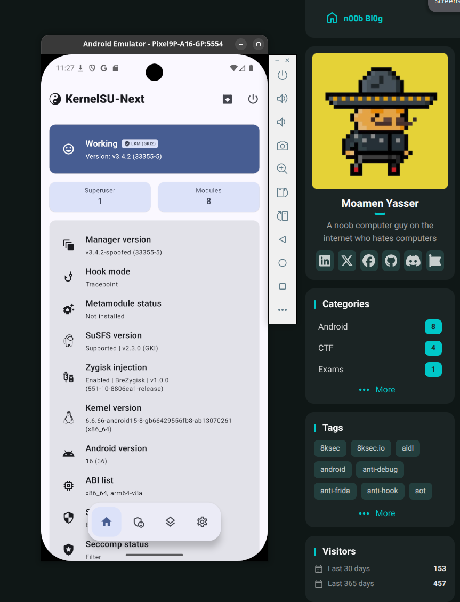

# susfs4ksu-lkm-x64

x86_64 port of [inforcqb/susfs4ksu-lkm](https://github.com/inforcqb/susfs4ksu-lkm): susfs as a loadable kernel module for the Android 16 x86_64 emulator image, whose kernel comes from the android15-6.6 branch (6.6.66-android15-8), running beside KernelSU-Next LKM. No custom kernel, nothing replaces the ramdisk. 

Please use [KernelSU-Next-AVD](https://github.com/ymuuuu/KernelSU-Next-AVD) to root your AVD.

## Build

Pushes to main run four jobs: `arm64-control` (upstream module, unchanged, catches regressions), `x86_64-port` (this port, android15-6.6), `x86_64-matrix` (the other KMIs the KernelSU-Next CI covers, android12-5.10 up to android17-6.18) and `x86_64-package`. All must be green. Artifacts per run: `x86_64-android15-6.6-susfs_guard_lkm.ko`, the per-KMI `x86_64-<kmi>-susfs_guard_lkm.ko` set, `x86_64-susfs_sc` (bare supercall test client) and `x86_64-susfs-lkm-module` (the flashable loader module zip, one .ko per KMI, the boot script picks by kernel release). Prebuilt binaries: the [releases](https://github.com/ymuuuu/susfs4ksu-lkm-x64/releases) page.

## Install

The module zip is the intended path: KernelSU-Next manager, module section, install from storage, reboot (or `ksud module install susfs_lkm_x64.zip`). After reboot the module loads itself at boot and installs the x86_64 `susfs` CLI at `/data/adb/ksu/bin/susfs` (with `sus` and `ksu_susfs` symlinks) for manager modules that call the classic command line. Check with `ksud susfs version`, expect v2.3.0.

For a manual one-shot load instead: plain `insmod` cannot work, five imports are unexported to modules on every GKI variant, arm64 included, same as upstream. Use `ksud insmod <path-to-.ko>`. The module hides itself from lsmod on purpose; check `/sys/module/susfs_guard_lkm` instead.

## State

Live-tested on the emulator: autoload after reboot, `ksud susfs version` answers v2.3.0 and `ksud susfs support` answers Supported, sus_path hides paths from app uids while root and shell still see them, uname spoof, kstat/opath/open_redirect tables, no-opt probes holding. v1 scope: the AArch32 compat layer stays arm64-only.

Userspace talks through the reboot-ABI supercall and the `/proc/susfs_*` nodes (interface reference: upstream [PROC_INTERFACES.md](https://github.com/inforcqb/susfs4ksu-lkm/blob/main/PROC_INTERFACES.md)). 

> IMPORTANT: Manager modules that ship their own arm64 `susfs`/`ksu_susfs` binaries (BRENE, sidex15) still carry a dead arm64 binary inside; the installed CLI here answers the same command surface, but those modules' installers may need their arch gate bypassed.
Short Answer: susfs4ksu-module and all its forks still needs to be ported to x86_64

## Origin and license

Port of inforcqb/susfs4ksu-lkm, which ports simonpunk/susfs4ksu (logic and hook points), with patch_memory/lsm_hook/symbol_resolver from SukiSU-Ultra. GPL-2.0-only, see LICENSE. Research and learning only, use at your own risk.

## Disclaimer
I am no developer or a low level programmer, I am a guy who loves breaking, testing, building security releated tools that helps with my workflow, excpect bugs and errors, thank you.